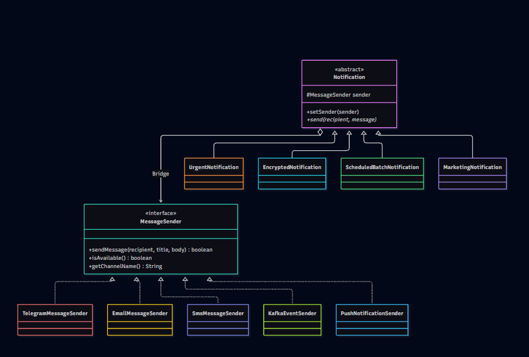

# Assignment 3 — Multi-Channel Notification Gateway

**Course:** Software Design Patterns  
**Language:** Java 25  
**Design Pattern:** Bridge Pattern  
**Build Tool:** Maven  
**Testing:** JUnit 5

## 1. Project Overview

This project implements a Multi-Channel Notification Gateway using the Bridge Design Pattern.

The system supports different notification types and delivery providers. The Bridge Pattern separates notification behavior from message delivery, allowing both hierarchies to evolve independently.

All delivery providers are simulated. No real external APIs are required.

## 2. Project Architecture

The system contains two independent hierarchies.

**Abstraction hierarchy:**
- `Notification` — abstract base class.
- `UrgentNotification` — adds an urgent prefix and supports fallback.
- `EncryptedNotification` — encodes messages using Base64.
- `ScheduledBatchNotification` — sends messages to multiple recipients and produces a summary.
- `MarketingNotification` — adds promotional content.

**Implementor hierarchy:**
- `MessageSender` — common interface for delivery providers.
- `TelegramMessageSender` — supports formatted messages.
- `EmailMessageSender` — supports subjects and signatures.
- `SmsMessageSender` — enforces a 160-character message limit.
- `KafkaEventSender` — simulates event publishing.
- `PushNotificationSender` — simulates device notifications.

## 3. UML Class Diagram



The diagram shows inheritance, interface implementation, and the Bridge relationship between `Notification` and `MessageSender`.

## 4. Bridge Pattern Explanation

### What are the two independent dimensions?

The two dimensions are notification types and message delivery providers.

### Where exactly is the Bridge?

The Bridge is the `MessageSender sender` reference inside the abstract `Notification` class. It connects the abstraction to the implementor interface.

### Why is inheritance problematic here?

Using inheritance for every combination would create too many classes. With four notification types and five providers, we could need 20 separate combination classes.

Bridge avoids this class explosion.

### What happens when a new provider is added?

A new class implements the `MessageSender` interface. Existing notification classes do not need to be modified.

For example, `PushNotificationSender` was added without changing `Notification`.

### What happens when a new notification type is added?

A new class extends `Notification` and implements its own `send()` behavior.

For example, `MarketingNotification` works with existing delivery providers.

### Why is this Bridge rather than Adapter?

Bridge separates abstraction and implementation by design, allowing both to evolve independently.

Adapter makes incompatible existing interfaces work together.

## 5. Required Demonstration Scenarios

The `Main.java` class demonstrates all six required scenarios:

1. UrgentNotification + Telegram
2. EncryptedNotification + Email
3. ScheduledBatchNotification + SMS
4. Runtime switching from Telegram to Email
5. Telegram unavailable → SMS fallback
6. MarketingNotification + PushNotificationSender

## 6. Runtime Provider Switching

The system supports changing the sender at runtime using `setSender()`.

The same notification object can use Telegram first and Email afterward without changing its class.

## 7. Fallback Mechanism

`UrgentNotification` supports a backup sender.

If the primary sender is unavailable or delivery fails, the system attempts delivery through the fallback sender.

The mechanism depends on the `MessageSender` interface rather than checking concrete sender types.

## 8. Unit Testing

The project contains 10 JUnit 5 tests covering:

1. Successful delivery
2. Unavailable provider
3. Fallback delivery
4. SMS length restriction
5. Base64 message encoding
6. Batch notification
7. Runtime sender switching
8. PushNotificationSender
9. MarketingNotification
10. Failed fallback delivery

All 10 tests passed during development.

## 9. How to Run

**Requirements:**
- JDK 17 or newer
- Maven
- IntelliJ IDEA or another Java IDE

**Run the application:**

Open the project in IntelliJ IDEA and execute `Main.java`.

Alternatively, compile the project with Maven and run the main class:

```bash
mvn compile
java -cp target/classes Main
```

**Run unit tests:**

```bash
mvn test
```

## 10. Independent Extension

The system was extended with `PushNotificationSender` and `MarketingNotification`.

These additions demonstrate the main advantage of the Bridge Pattern: new notification types and delivery providers can be added independently without modifying existing implementations.

## 11. Conclusion

The Multi-Channel Notification Gateway demonstrates the Bridge Pattern through composition, interfaces, polymorphism, runtime switching, and independent extension.

The design reduces unnecessary subclasses and makes the application easier to maintain and extend.